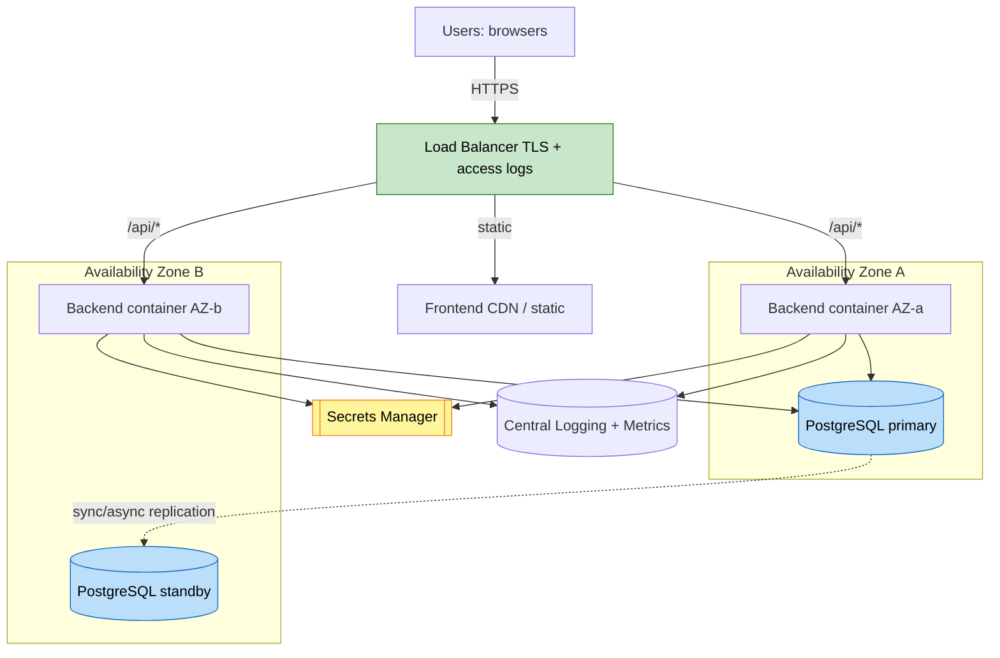

# Deployment Architecture — Unit U1 (within shared platform)

U1 deploys as part of the single backend container. This diagram shows where U1 concerns sit in the shared topology.

## Diagram



## Text Alternative
```
Users --HTTPS--> Load Balancer (TLS, access logs)
  -> /api/* -> Backend containers in AZ-a and AZ-b (stateless, U1 auth/authz/cycles live here)
  -> static -> Frontend (CDN/static)
Backend -> PostgreSQL primary (AZ-a), replicated to standby (AZ-b)
Backend -> Secrets Manager (DB creds, MFA secrets)
Backend -> Central Logging + Metrics (audit log stream, auth metrics)
```

## Deployment Flow (U1 within pipeline)
1. Build backend image (includes U1 module), scan dependencies, produce SBOM.
2. Deploy as canary (subset of traffic).
3. Health checks (Actuator readiness incl. DB connectivity) + auth metrics monitored.
4. Promote on success, or auto-rollback to previous image on health/metric regression (R5=C, R6=D).

## U1 Runtime Characteristics
- Stateless replicas across 2 AZs; session externalized.
- Scheduled cycle-close is singleton-effective (ShedLock) across replicas.
- Auth endpoints rate-limited and access-logged at the load balancer.
