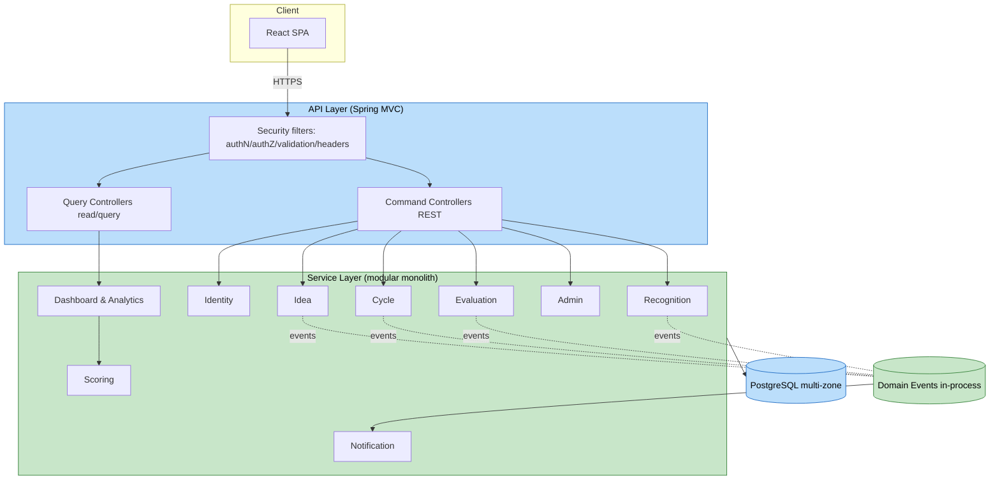

# Application Design (Consolidated) — Ideation Portal

This document consolidates the application design. Detailed artifacts:
- `components.md` — component definitions, responsibilities, interfaces
- `component-methods.md` — method signatures and input/output types
- `services.md` — service layering and orchestration
- `component-dependency.md` — dependency matrix, events, data flow

## 1. Architectural Decisions (from Application Design plan)

| Decision | Choice | Rationale |
|---|---|---|
| Backend style (Q1) | Modular monolith, service-extractable | Faster start, simpler ops, single Docker image; boundaries allow later extraction |
| API style (Q2) | REST commands + dedicated read/query API | Clear separation of writes vs read-optimized dashboard queries |
| Component boundaries (Q3) | 9 domains | Confirmed by user |
| Aggregation timing (Q4) | On read | User choice; scalability flagged for NFR Design |
| Analytics approach (Q5) | Deferred to NFR/Infra Design | Decide engine when NFRs are finalized |
| Notifications (Q6) | Email only (v1) | Simpler v1 scope |
| Internal comms (Q7) | In-process calls + domain events | Decouples side effects (notifications, recognition) |

## 2. Component Overview

1. **Identity & Access** — auth, authz, users/roles, SSO-ready
2. **Idea Management** — drafts, submission, ownership, lifecycle
3. **Cycle Management** — time-boxed cycles, open/close gating
4. **Evaluation** — assignment + independent scoring
5. **Scoring & Aggregation** — weighted-sum, on-read aggregation, ranking/tie-break (pure, PBT target)
6. **Dashboard & Analytics** — read/query API (dashboards, leaderboards, analytics)
7. **Recognition** — top-3 determination and awarding
8. **Notification** — email delivery via abstraction (event-driven)
9. **Administration** — thin orchestration (users, criteria/weights, cycles, assignment, recognition trigger)

Plus cross-cutting concerns: Security (filters), Observability (logging/metrics/tracing/health), Persistence (PostgreSQL repositories).

## 3. Architecture Diagram



### Text Alternative
```
React SPA --HTTPS--> API Layer (security filters -> command + query controllers)
Command controllers -> domain services (Identity, Idea, Cycle, Evaluation, Admin, Recognition)
Query controllers   -> Dashboard & Analytics -> Scoring/Aggregation
All services        -> PostgreSQL (multi-zone)
Services publish domain events -> Notification -> Email
```

## 4. Traceability Summary
- Every functional requirement (FR-1..FR-10) maps to at least one component and method.
- Security Baseline reflected via dedicated Identity module, API security filters, repository parameterization.
- Resiliency Baseline reflected via event-decoupled side effects, graceful degradation of notifications, and a read/query separation; HA/backup/scaling specifics are elaborated in NFR Design and Infrastructure Design.
- Scoring & Aggregation isolated as pure logic to support PBT (NFR-T3).

## 5. Open Items for Downstream Stages
- **NFR Design**: validate on-read aggregation performance at enterprise scale; consider caching/materialized views if needed; finalize circuit breaker/timeout placement; authz pattern details.
- **Infrastructure Design**: container orchestration platform, multi-zone PostgreSQL config, load balancing, auto-scaling, canary pipeline, backup configuration; analytics engine decision (Q5 deferred).
- **Functional Design**: exact DTOs, validation bounds, weight normalization, aggregation formula, tie-break precedence, state-transition guards; PBT-01 property identification.
