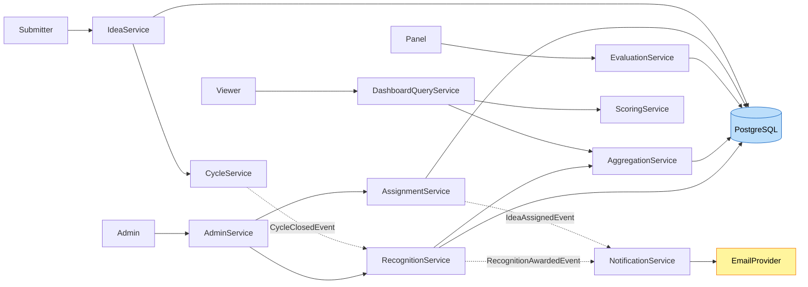

# Component Dependencies — Ideation Portal

Dependency relationships, communication patterns, and data flow between components. Solid dependencies are synchronous in-process service calls; event dependencies are asynchronous internal domain events (Q7=B).

---

## Dependency Matrix

"calls" = synchronous service call; "event" = async domain event; blank = no direct dependency.

| From \ To | Identity | Idea | Cycle | Evaluation | Scoring | Dashboard/Analytics | Recognition | Notification | Admin |
|---|---|---|---|---|---|---|---|---|---|
| Identity | — | | | | | | | | |
| Idea | calls | — | calls | | | | | | |
| Cycle | calls | | — | | | | | | |
| Evaluation | calls | calls | calls | — | | | | | |
| Scoring | | calls | | calls | — | | | | |
| Dashboard/Analytics | calls | calls | calls | calls | calls | — | calls | | |
| Recognition | | calls | calls | | calls | | — | event | |
| Notification | | | | | | | | — | |
| Admin | calls | | calls | calls | | | calls | | — |

Notes:
- All components depend on **Identity** (Authorization) for access checks (shown where a direct call exists; authorization guards are also applied at the API layer globally).
- **Notification** has no outbound domain dependencies; it only consumes events and calls the `EmailProvider` abstraction.
- **Dashboard/Analytics** is read-only and reads from multiple components' data via repositories/services.

---

## Event Flow

| Event | Publisher | Subscriber(s) | Purpose |
|---|---|---|---|
| IdeaAssignedEvent | Evaluation (via Admin.assign) | Notification | Email panel members about new assignment |
| CycleClosedEvent | Cycle | Recognition | Mark cycle eligible for recognition |
| RecognitionAwardedEvent | Recognition | Notification | Email submitter + management |

---

## Data Flow (primary journeys)

### Text representation
```
Submit:   Submitter -> API(command) -> IdeaService -> CycleService(check open) -> PostgreSQL(Idea=Submitted)

Assign:   Admin -> API(command) -> AdminService -> AssignmentService -> PostgreSQL(Assignment, Idea=UnderEval)
                                              \-> publish IdeaAssignedEvent -> NotificationService -> EmailProvider

Evaluate: Panel -> API(command) -> EvaluationService -> (verify assignment + cycle open) -> PostgreSQL(Evaluation)

Dashboard: Viewer -> API(query/poll) -> DashboardQueryService -> AggregationService + ScoringService
                                      -> read Evaluations + Weights -> DashboardView

Recognize: Cycle.close -> CycleClosedEvent
           Admin.triggerRecognition -> RecognitionService -> AggregationService.rankIdeas
                                     -> PostgreSQL(Idea=Recognized/Rejected, Badge)
                                     -> publish RecognitionAwardedEvent -> NotificationService -> EmailProvider
```

### Mermaid diagram


---

## Coupling & Cohesion Notes
- High cohesion within each domain; coupling limited to published interfaces + events.
- No cyclic dependencies: Notification is a pure sink; Dashboard/Analytics is a pure reader; Admin is a thin orchestrator.
- Scoring is dependency-light and pure (ideal for PBT).
