# Execution Plan — Ideation Portal

## Detailed Analysis Summary

### Project Context
- **Project Type**: Greenfield
- **Request**: Full-stack Ideation Portal (React + Spring Boot + PostgreSQL, Dockerized)
- **Scope**: System-wide — new application built from scratch
- **Enabled Extensions**: Security Baseline (full), Resiliency Baseline (full), Property-Based Testing (partial)

### Change Impact Assessment
- **User-facing changes**: Yes — four roles with distinct workflows (submit, evaluate, administer, view)
- **Structural changes**: Yes — entire architecture (frontend, backend, data tier, container platform)
- **Data model changes**: Yes — users/roles, ideas, cycles, criteria/weights, assignments, evaluations, recognition, audit, notifications
- **API changes**: Yes — new REST API surface
- **NFR impact**: Yes — security, resiliency (99.95%, multi-zone), performance (enterprise scale), testing (PBT)

### Risk Assessment
- **Risk Level**: Medium-High (new enterprise system, multiple components, security + resiliency constraints)
- **Rollback Complexity**: Moderate (greenfield; canary deployment with auto-rollback planned)
- **Testing Complexity**: Complex (multi-persona flows, scoring/aggregation logic, PBT, integration across tiers)

## Workflow Visualization

```mermaid
flowchart TD
    Start(["User Request"])

    subgraph INCEPTION["INCEPTION PHASE"]
        WD["Workspace Detection<br/><b>COMPLETED</b>"]
        RA["Requirements Analysis<br/><b>COMPLETED</b>"]
        US["User Stories<br/><b>COMPLETED</b>"]
        WP["Workflow Planning<br/><b>IN PROGRESS</b>"]
        AD["Application Design<br/><b>EXECUTE</b>"]
        UG["Units Generation<br/><b>EXECUTE</b>"]
    end

    subgraph CONSTRUCTION["CONSTRUCTION PHASE"]
        FD["Functional Design<br/><b>EXECUTE</b>"]
        NFRA["NFR Requirements<br/><b>EXECUTE</b>"]
        NFRD["NFR Design<br/><b>EXECUTE</b>"]
        ID["Infrastructure Design<br/><b>EXECUTE</b>"]
        CG["Code Generation<br/><b>EXECUTE</b>"]
        BT["Build and Test<br/><b>EXECUTE</b>"]
    end

    subgraph OPERATIONS["OPERATIONS PHASE"]
        OPS["Operations<br/><b>PLACEHOLDER</b>"]
    end

    Start --> WD
    WD --> RA
    RA --> US
    US --> WP
    WP --> AD
    AD --> UG
    UG --> FD
    FD --> NFRA
    NFRA --> NFRD
    NFRD --> ID
    ID --> CG
    CG --> BT
    BT --> OPS
    BT --> End(["Complete"])

    style WD fill:#4CAF50,stroke:#1B5E20,stroke-width:3px,color:#fff
    style RA fill:#4CAF50,stroke:#1B5E20,stroke-width:3px,color:#fff
    style US fill:#4CAF50,stroke:#1B5E20,stroke-width:3px,color:#fff
    style WP fill:#4CAF50,stroke:#1B5E20,stroke-width:3px,color:#fff
    style AD fill:#FFA726,stroke:#E65100,stroke-width:3px,stroke-dasharray: 5 5,color:#000
    style UG fill:#FFA726,stroke:#E65100,stroke-width:3px,stroke-dasharray: 5 5,color:#000
    style FD fill:#FFA726,stroke:#E65100,stroke-width:3px,stroke-dasharray: 5 5,color:#000
    style NFRA fill:#FFA726,stroke:#E65100,stroke-width:3px,stroke-dasharray: 5 5,color:#000
    style NFRD fill:#FFA726,stroke:#E65100,stroke-width:3px,stroke-dasharray: 5 5,color:#000
    style ID fill:#FFA726,stroke:#E65100,stroke-width:3px,stroke-dasharray: 5 5,color:#000
    style CG fill:#4CAF50,stroke:#1B5E20,stroke-width:3px,color:#fff
    style BT fill:#4CAF50,stroke:#1B5E20,stroke-width:3px,color:#fff
    style OPS fill:#BDBDBD,stroke:#424242,stroke-width:2px,stroke-dasharray: 5 5,color:#000
    style INCEPTION fill:#BBDEFB,stroke:#1565C0,stroke-width:3px,color:#000
    style CONSTRUCTION fill:#C8E6C9,stroke:#2E7D32,stroke-width:3px,color:#000
    style OPERATIONS fill:#FFF59D,stroke:#F57F17,stroke-width:3px,color:#000
    style Start fill:#CE93D8,stroke:#6A1B9A,stroke-width:3px,color:#000
    style End fill:#CE93D8,stroke:#6A1B9A,stroke-width:3px,color:#000

    linkStyle default stroke:#333,stroke-width:2px
```



### Text Alternative (always included)
```
INCEPTION PHASE
- Workspace Detection: COMPLETED
- Requirements Analysis: COMPLETED
- User Stories: COMPLETED
- Workflow Planning: IN PROGRESS
- Application Design: EXECUTE
- Units Generation: EXECUTE

CONSTRUCTION PHASE (per unit)
- Functional Design: EXECUTE
- NFR Requirements: EXECUTE
- NFR Design: EXECUTE
- Infrastructure Design: EXECUTE
- Code Generation: EXECUTE (always)
- Build and Test: EXECUTE (always)

OPERATIONS PHASE
- Operations: PLACEHOLDER
```

## Phases to Execute

### 🔵 INCEPTION PHASE
- [x] Workspace Detection (COMPLETED)
- [x] Reverse Engineering (SKIPPED — greenfield, no existing code)
- [x] Requirements Analysis (COMPLETED)
- [x] User Stories (COMPLETED)
- [x] Workflow Planning (IN PROGRESS)
- [ ] Application Design — **EXECUTE**
  - **Rationale**: New system needs component identification, service-layer design, and component dependencies (ideas, evaluation, recognition, admin, auth, notification domains).
- [ ] Units Generation — **EXECUTE**
  - **Rationale**: The system naturally decomposes into multiple units (e.g., identity/auth, idea submission, evaluation, dashboards/analytics, recognition, admin/cycles). Structured breakdown enables coherent construction.

### 🟢 CONSTRUCTION PHASE (per unit)
- [ ] Functional Design — **EXECUTE**
  - **Rationale**: New data models and non-trivial business logic (weighted scoring, aggregation, cycle lifecycle, tie-breaking, assignment). Also required for PBT-01 property identification.
- [ ] NFR Requirements — **EXECUTE**
  - **Rationale**: Enterprise scale, security and resiliency baselines, and PBT framework selection (jqwik) must be captured per unit.
- [ ] NFR Design — **EXECUTE**
  - **Rationale**: Security, resiliency, and performance patterns must be incorporated into the design (authz, encryption, HA, circuit breaking, observability).
- [ ] Infrastructure Design — **EXECUTE**
  - **Rationale**: Dockerized, single-region multi-zone topology, PostgreSQL multi-zone, load balancing, auto-scaling, canary deploy, backups — infrastructure must be specified.
- [ ] Code Generation — **EXECUTE (ALWAYS)**
  - **Rationale**: Implementation of all units with tests.
- [ ] Build and Test — **EXECUTE (ALWAYS)**
  - **Rationale**: Build all units; unit, integration, and PBT execution; verification.

### 🟡 OPERATIONS PHASE
- [ ] Operations — PLACEHOLDER
  - **Rationale**: Future deployment/monitoring; DR testing/chaos plan (R9=B) will be captured for Operations execution.

## Estimated Timeline
- **Total Stages to Execute (remaining)**: 6 construction stages (per unit) + 2 inception stages
- **Estimated Duration**: Multi-session; proceeds stage-by-stage with approval gates.

## Success Criteria
- **Primary Goal**: A working, secure, resilient Ideation Portal implementing all 6 features for 4 roles.
- **Key Deliverables**: Application design, units, per-unit functional/NFR/infra designs, generated code with tests, build & test instructions.
- **Quality Gates**: Security Baseline (full) compliance, Resiliency Baseline (full) compliance, PBT (partial) compliance, requirements/story traceability, passing build and tests.
